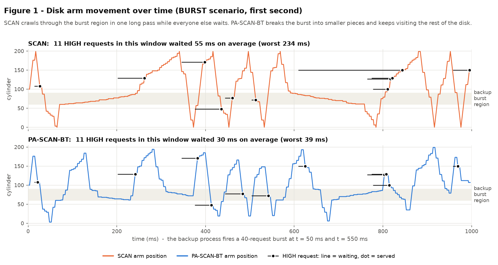
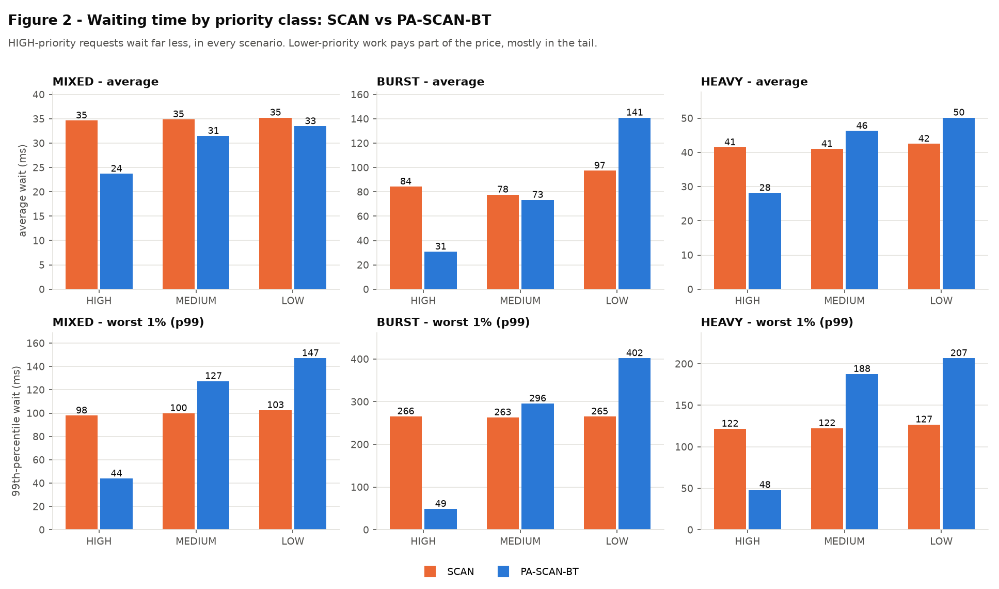

# Priority-Aware Elevator (SCAN) Disk Scheduler with Burst-Throttling

**Operating Systems course project (Fall 2026-27), problem statement #3**

This project simulates a hard disk and compares the classic **SCAN (elevator)** disk-scheduling
algorithm against an improved version, **PA-SCAN-BT**, that adds three rules:

| Rule | What it does | Problem it fixes |
|---|---|---|
| **1. Priority guard** | A HIGH-priority request must start within 40 ms. If the normal sweep would make it late, the arm goes to it straight away. | Critical I/O (page faults) stuck behind bulk work |
| **2. Burst-throttling** | Each process may get only K requests (LOW) or 2K (MEDIUM) served per sweep. Extra requests wait for a later sweep. | One bursty process holding the head "hostage" |
| **3. Aging** | A request that has waited 150 ms can no longer be throttled. | Starvation caused by Rule 2 |

New to the topic? Read **[`docs/PROJECT_GUIDE.md`](docs/PROJECT_GUIDE.md)**. It explains everything from
"what is a cylinder" up to the viva questions. For what is finished and what is left, see
**[`docs/PROJECT_STATUS.md`](docs/PROJECT_STATUS.md)**. Presenting the project? Read
**[`docs/PRESENTATION_GUIDE.md`](docs/PRESENTATION_GUIDE.md)**: the demo script, what is novel, and the likely questions.

## ▶ The working model: `python app.py`

```bash
pip install -r requirements.txt
python app.py              # opens http://127.0.0.1:8050 in your browser (no internet needed)
```

A live, interactive lab that runs **the same Python algorithms** as the benchmark:

| Tab | What you can do |
|---|---|
| **Disk Lab** | Watch SCAN and PA-SCAN-BT (or any 4 of the 6 algorithms) side by side: the queue, the arm, and a "waterfall" of its path where every waiting HIGH request is a bar that turns red after its deadline. **Press 💥 Backup burst or ⚡ Page faults while it runs** and watch each algorithm react. Click a decision in the log to have it explained. |
| **LLM Serving Lab** | The same three rules scheduling a GPU that serves an LLM: 32 batch slots, waiting requests by prompt prefix, the sweep head, live time-to-first-token and SLO %. Press 🌊 Flood or 💬 Chat users. |
| **AI Co-pilot** | Describe a workload in English ("a database server during the nightly backup") and run it. Then let the **verified auto-tuner** suggest K / deadline / aging: Claude proposes, a grid search competes, and the simulator accepts only what wins on unseen random workloads. |
| **How it works** | A one-page summary and a 5-minute demo plan. |

The co-pilot uses Claude (`claude-opus-5-5`) if `pip install anthropic` has been run and `ANTHROPIC_API_KEY` is
set. Otherwise it switches automatically to offline engines (keyword parser, rule templates, grid search), so
the demo never depends on the internet.

**Why live injection is honest:** a scheduler can only see requests that have already arrived. An event
injected at time *t* therefore cannot change any decision taken before *t*. The lab re-runs the simulation
with the new requests and carries on from *t*, and `tests/test_lab.py` checks this property.

---

## How the faculty's 3 required components map to files

| Required component | File |
|---|---|
| 1. Baseline algorithm | `scheduler/baseline.py` → `SCAN` (plus FCFS, SSTF, C-SCAN, LOOK for reference) |
| 2. Enhanced variant (priority-aware) | `scheduler/enhanced.py` → `PriorityThrottledSCAN` |
| 3. Comparison graphs | `scheduler/plots.py` → 7 PNG files in `results/` |

## Folder structure

```
PA-SCAN-BT-Disk-Scheduler/
├── main.py                 ← disk benchmark: tables, CSVs and the 7 graphs
├── llm_main.py             ← LLM-serving benchmark: tables, CSVs and 6 graphs
├── app.py                  ← the LIVE LAB (working model) in your browser
├── config.py               ← every number (disk size, timings, K, deadline...) in one place
├── requirements.txt        ← matplotlib (+ optional anthropic for the co-pilot)
│
├── scheduler/              ← the disk scheduler
│   ├── request.py          ← what one disk request looks like
│   ├── baseline.py         ← COMPONENT 1: FCFS, SSTF, SCAN, C-SCAN, LOOK
│   ├── enhanced.py         ← COMPONENT 2: PA-SCAN-BT (our algorithm)
│   ├── simulator.py        ← the clock: feeds requests to any algorithm, records times
│   ├── workloads.py        ← built-in scenarios + custom workloads
│   ├── metrics.py          ← turns a run into numbers (wait times, head movement, ...)
│   └── plots.py            ← COMPONENT 3: draws the comparison graphs
│
├── llm_serving/            ← the same three rules on an LLM inference server
│   └── (config, request, server, baseline, enhanced, simulator, workloads, metrics, plots)
│
├── lab/                    ← the live lab (Python standard library only)
│   ├── server.py           ← tiny web server on 127.0.0.1
│   ├── disk_api.py         ← runs disk algorithms (+ injected events) for the browser
│   ├── llm_api.py          ← runs LLM policies (+ injected events) for the browser
│   ├── copilot.py          ← AI co-pilot: English → workload, explanations, verified tuner
│   └── static/             ← the dashboard (HTML/CSS/JS, no internet needed)
│
├── tests/                  ← 44 automatic checks: python -m unittest discover tests -v
│   ├── test_scheduler.py   ← textbook answers + PA-SCAN-BT rules (14)
│   ├── test_llm_serving.py ← the LLM extension (12)
│   └── test_lab.py         ← live lab + co-pilot guardrails (18)
│
├── results/                ← created by main.py / llm_main.py: graphs + CSV tables
└── docs/
    ├── PROJECT_GUIDE.md        ← the full beginner's guide + viva questions
    ├── PROJECT_STATUS.md       ← what is done, latest numbers, open items
    └── PRESENTATION_GUIDE.md   ← how to demo and explain the project
```

## How to run

You need **Python 3.8 or newer**.

```bash
# 1. install the plotting library (one time only)
pip install -r requirements.txt

# 2. the full experiment: prints tables, writes graphs + CSVs into results/  (~10 seconds)
python main.py

# other modes
python main.py --demo     # tiny 14-request example, explained step by step (use this in the viva)
python main.py --show     # full run, and also opens the graphs in windows
python main.py --quick    # 3 random seeds instead of 10 (faster while experimenting)

# 3. run the correctness tests (44 tests, about 2 seconds)
python -m unittest discover tests -v

# 4. the live, interactive working model
python app.py
```

On Windows, if `python` is not found, use `py` instead (`py main.py`).

## Results (mean of 10 random workloads per scenario)

**PA-SCAN-BT compared with SCAN** (negative = better):

| Metric | MIXED (130 req/s) | BURST (100 req/s + backup bursts) | HEAVY (160 req/s) |
|---|---|---|---|
| HIGH-priority average wait | 34.6 → 23.7 ms (**−32%**) | 84.3 → 30.8 ms (**−63%**) | 41.5 → 28.1 ms (**−32%**) |
| HIGH-priority 99th-percentile wait | 97.8 → 43.8 ms (**−55%**) | 265.5 → 48.6 ms (**−82%**) | 121.7 → 47.9 ms (**−61%**) |
| Normal (non-bursty) processes, avg wait | same as all requests | 81.2 → 66.8 ms (**−18%**) | same as all requests |
| All requests, average wait | 35.1 → 32.0 ms (−9%) | 93.4 → 123.4 ms (+32%) | 41.9 → 46.7 ms (+11%) |
| All requests, 99th-percentile wait | 103.7 → 141.5 ms (+36%) | 270.2 → 399.4 ms (+48%) | 129.9 → 203.4 ms (+57%) |
| Total head movement | −4% | +1% | −1% |

**In one sentence:** PA-SCAN-BT gives critical requests a reliable latency bound (HIGH p99 ≈ 45 ms in every
scenario, against 98–266 ms for SCAN) and shields normal processes from bursty ones. The price is paid by
low-priority work and by the bursty process itself, mostly in the tail. That trade-off is deliberate, and
Figures 5–7 show exactly where it grows.

| Graph | What it shows |
|---|---|
| `fig1_head_trajectory.png` | Disk-arm path over time, SCAN vs PA-SCAN-BT, with HIGH requests' waiting marked |
| `fig2_wait_by_priority.png` | Average and p99 wait per priority class, 3 scenarios |
| `fig3_all_algorithms.png` | FCFS / SSTF / SCAN / C-SCAN / LOOK / PA-SCAN-BT side by side |
| `fig4_per_process_wait.png` | Which process pays for the burst |
| `fig5_load_sweep.png` | How waits grow as the arrival rate increases |
| `fig6_ablation.png` | What each of the 3 rules contributes on its own |
| `fig7_sensitivity.png` | Effect of the two knobs: burst threshold K and HIGH deadline |




## Simulation assumptions (state these in your report)

* Disk of 200 cylinders (0–199), the textbook size. The head starts at 100, moving up.
* Moving the arm costs 0.1 ms per cylinder, so a full stroke takes 20 ms. Reading a request costs a fixed 4 ms
  (average rotational latency at 7200 RPM, plus transfer). These are typical hard-disk figures.
* Requests arrive as a Poisson process from 6 background processes with fixed priorities
  (10% HIGH, 30% MEDIUM, 60% LOW). The BURST scenario adds a backup process that fires 40 LOW requests
  into cylinders 60–90 every 500 ms.
* The scheduler decides only when the disk is free. Once a seek starts, it finishes (non-preemptive),
  which is how real disks work.
* Every algorithm gets **identical** request lists (same random seed), and results are averaged over 10 seeds.
* **Known limitation:** the priority guard assumes a full sweep (20 ms) is short compared with the HIGH deadline
  (40 ms). On an overloaded disk where one sweep takes longer than the deadline, the guard keeps turning the
  arm around and PA-SCAN-BT does worse than SCAN (see `docs/PROJECT_GUIDE.md`, Q19).

## Extension: the same algorithm as an LLM inference serving scheduler

`llm_serving/` applies PA-SCAN-BT's three rules to a continuous-batching LLM server (the
vLLM / TGI / SGLang style of engine), simulated in the same way as the disk.
Before every model step, the scheduler decides which waiting requests join the running batch.

| Disk project | LLM serving project |
|---|---|
| cylinder, head position | prefix id (the shared system prompt or document a prompt starts with), the last prefix admitted |
| seek cost | prefix-cache miss: the shared prompt has to be recomputed |
| process, HIGH / MEDIUM / LOW | tenant, INTERACTIVE / STANDARD / BATCH |
| waiting time | TTFT (time to first token) |
| backup burst | a tenant flooding the server with same-prefix BATCH requests |

**PA-SWEEP-BT** = an elevator over prefix ids, so requests sharing a prefix are admitted together and hit
the cache. On top of that:
1. **TTFT guard:** an INTERACTIVE request that is about to miss its 300 ms deadline is admitted at once.
   If the batch is full, a BATCH request is preempted (recomputed later, as vLLM does).
2. **Burst-throttling:** a tenant gets K (BATCH) or 2K (STANDARD) admissions per sweep.
3. **Aging:** a request older than 5 s can't be throttled, and nothing is preempted more than twice.

It is compared against FCFS, strict PRIORITY, FAIR-SHARE (a simplified Virtual Token Counter) and
PREFIX-SWEEP (the baseline: the elevator with no rules).

```bash
python llm_main.py            # full benchmark -> tables, results/llm/*.csv and 6 graphs
python llm_main.py --demo     # 10 requests on a 4-slot server, explained step by step
python llm_main.py --quick    # 2 seeds instead of 5
python -m unittest tests.test_llm_serving -v
```

Results (5 seeds, PA-SWEEP-BT compared with PREFIX-SWEEP, `results/llm/summary_*.csv`):

| Metric | FLOOD | HEAVY |
|---|---|---|
| INTERACTIVE avg TTFT | 1230 → 161 ms (**−87%**) | 134 → 79 ms (**−41%**) |
| INTERACTIVE p99 TTFT | 4657 → 309 ms (**−93%**) | 1031 → 270 ms (**−74%**) |
| INTERACTIVE within the 300 ms SLO | 43.9% → 97.8% | 88.2% → 99.5% |
| Non-flooding tenants, avg TTFT | 1125 → 608 ms (−46%) | n/a |
| Flooding tenant, avg TTFT (the price) | 828 → 1173 ms (+42%) | n/a |

Under FLOOD, PA-SWEEP-BT's INTERACTIVE p99 (309 ms) also beats strict PRIORITY (727 ms) and FAIR-SHARE (1046 ms).
FAIR-SHARE protects the non-flooding tenants better (288 ms vs 608 ms).

Server model (`llm_serving/config.py`): about a 7-8B model on one GPU. Up to 32 requests per batch,
80k tokens of KV cache, a 40k-token prefix cache, and step time = 6 ms + 0.25 ms per running request
+ 0.02 ms per prompt token prefilled. Capacity is roughly 10 requests/s on the default workload. The
model is deliberately simple: no chunked prefill, and each request reserves memory for its full output
when it is admitted.

## References

* A. Silberschatz, P. B. Galvin, G. Gagne, *Operating System Concepts*, 10th ed., Wiley. Chapter on
  mass-storage structure / HDD scheduling (FCFS, SSTF, SCAN, C-SCAN, LOOK).
* A. S. Tanenbaum, H. Bos, *Modern Operating Systems*, 4th ed., Pearson. Disk-arm scheduling and the elevator algorithm.
* A. L. N. Reddy, J. Wyllie, "Disk scheduling in a multimedia I/O system", *Proc. ACM Multimedia*, 1993
  (SCAN-EDF: combining deadlines with the elevator, the idea behind Rule 1).
* Linux kernel documentation, "Deadline IO scheduler tunables" (`Documentation/block/deadline-iosched.rst`):
  a real elevator that jumps to requests whose deadline has expired.
* P. Valente, F. Checconi, "High Throughput Disk Scheduling with Fair Bandwidth Distribution",
  *IEEE Transactions on Computers*, 2010 (BFQ: per-process budgets, related to Rule 2).
* W. Kwon et al., "Efficient Memory Management for Large Language Model Serving with PagedAttention",
  *SOSP* 2023 (vLLM: continuous batching, recompute-style preemption).
* Y. Sheng et al., "Fairness in Serving Large Language Models", *OSDI* 2024 (Virtual Token Counter,
  the FAIR-SHARE baseline).
* L. Zheng et al., "SGLang: Efficient Execution of Structured Language Model Programs", 2024
  (RadixAttention: prefix-cache-aware scheduling).
